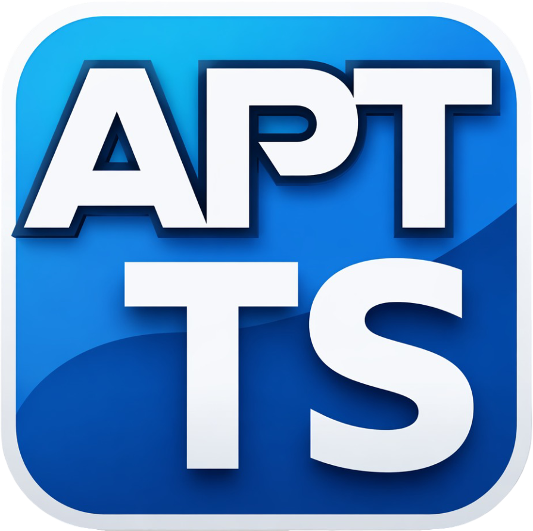

#  ts-apt

[](https://www.npmjs.com/package/ts-apt)
[](https://github.com/awalsh128/ts-apt/releases)
[](https://github.com/awalsh128/ts-apt/actions/workflows/ci.yml?query=branch%3Amain)
[](https://github.com/awalsh128/ts-apt/actions/workflows/ci.yml?query=branch%3Astaging)
[](https://codecov.io/gh/awalsh128/ts-apt)
[](https://github.com/awalsh128/ts-apt/blob/main/LICENSE)

TypeScript library for APT package operations on Debian-based Linux systems. It supports both standard APT binaries and the [apt-fast](https://github.com/ilikenwf/apt-fast) bundled wrapper.

- 📦 Install, remove, upgrade and search packages, and read package metadata and installed file lists
- ⚡ Uses apt-fast when available, with automatic fallback to apt-get
- 🔌 Structured command execution through pluggable command runners
- 🧱 Typed errors for validation, availability and command failures
- 🔒 Safe locking for mutating operations, with parallelism for read-only ones

[](https://github.com/sponsors/awalsh128)

If you find this project useful, please consider [sponsoring it](https://github.com/sponsors/awalsh128) and
show some ❤️ for open source maintainers.

> [!IMPORTANT]
> `sudo` is required for mutating operations. If the running user does not have sudo privilege the calls will
> fail.

## Quick Start

Requires Node.js 24+ and a Linux environment with APT tooling available.

```bash
npm install ts-apt
```

```ts
import { createPackageManager } from "ts-apt";

const manager = await createPackageManager(false);

const searchResults = await manager.search(["vim", "python"]);
const installed = await manager.listInstalled();

console.log(searchResults.length, installed.length);
```

## API Documentation

The published API reference is at [awalsh128.com/ts-apt](https://awalsh128.com/ts-apt/). See all of my published APIs at
[awalsh128.com/api](https://awalsh128.com/api/).

To generate it locally, run `npm run docs:api`. The output is written to `docs/api`, which is not committed.

## Testing

```bash
npm run test:unit
npm run test:integration
```

Integration tests run against real APT tooling and are slower than unit tests.

## Credits

- [ilikenwf/apt-fast](https://github.com/ilikenwf/apt-fast) - Optimized fast APT downloads.
- [moll/js-internet-message](https://github.com/moll/js-internet-message) - RFC compliant parsing of some apt output to avoid brittle string parsing.

Development and release workflows are in [CONTRIBUTING.md](CONTRIBUTING.md).
